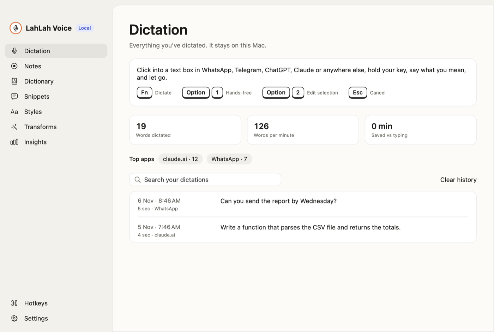

# LahLah Voice

Say what you mean, in any app. LahLah Voice turns natural speech into finished text: it removes pause
fillers and false starts, follows spoken corrections ("Tuesday, no wait, Wednesday"), and writes what
you intended. Everything runs on the device, using Apple's speech recognition and Apple Intelligence,
with an optional open model (Qwen3.5 through MLX) as the primary model or the fallback.



| | Mac | iPhone |
|---|---|---|
| Works in | Any app, by pasting into the focused text field | Any app, through a custom keyboard |
| Start dictating | Hold 🌐 Fn, double-tap it, or press Option+1 | Tap Speak on the keyboard |
| Edit by voice | Option+2 on selected text | Not available |
| Models | Apple Intelligence, Qwen3.5 2B, 4B or 9B; primary + fallback | Apple Intelligence, Qwen3.5 2B; primary + fallback |
| Style | Automatic per app category | Chosen on the keyboard |
| Distribution | Notarized DMG (Developer ID) | App Store |

Website: <https://alfredang.github.io/lahlahvoiceapp/>

The Android app (voice keyboard, Gemini Nano) lives in its own repo:
[lahlahvoiceapp_android](https://github.com/alfredang/lahlahvoiceapp_android).

## Mac features

- **Hotkeys you choose:** hold to talk, hands-free, edit selection, paste last dictation, open
  scratchpad and open LahLah Voice. Combinations can use up to 3 keys or a mouse button. The defaults are below.
- **Transforms:** saved instructions that rewrite selected text with one key press. A hotkey you
  press while setting one is kept even if you leave the page.
- **Scratchpad:** a floating window for rough notes.
- **Personalize:** dictionary, snippets, and a writing style for each type of app. AI assistants
  default to **Clear and concise**, which turns thinking aloud into clear sentences without losing a
  point or question, and fixes words the recogniser clearly misheard.
- **About You:** notes the model should know (your work, topics, spelling preferences), each for
  every app or one kind of app, plus a sample of your writing to match. They help it hear the right
  word and are never added to your text.
- **Learn words I correct** (off by default): if you fix a misheard word after a paste, that word is
  added to your dictionary.
- **Sending like a voice message:** while listening hands-free, Space or the Send button on the pill
  finishes, pastes and presses Return.
- **Notes and insights:** voice notes with Apple Intelligence summaries, and usage by app.
- **Wiki LLM and Planner:** their agent panels have a mic button that starts and stops hands-free
  dictation into the agent's terminal. It works over a local notification (`RemoteControl`) that's
  only accepted while one of those two apps is in front.
- **Optional settings:** start and stop sounds, muting speakers while dictating, a "press enter" voice
  command, and spelling names from the text box you're writing in.

| Default key | Action |
|---|---|
| Hold 🌐 Fn | Dictate until you let go |
| Double-tap 🌐 Fn, or Option+1 | Hands-free; press again to stop |
| Option+2 | Speak an edit to the selected text |
| Option+3 | Paste your last dictation |
| Option+4 | Open the scratchpad |
| Option+L | Open the LahLah Voice window |
| Esc | Cancel |

While Fn is a LahLah hotkey, its 🌐 press is kept from the app in front, so it never opens Emoji &
Symbols over the listening pill.

## How it works

```
Microphone → SpeechAnalyzer (on-device) → rule-based cleanup → Foundation Models → your dictionary → text
```

- **Rules** (`TranscriptCleaner`) always run. They handle fillers, stutters, spoken corrections, lists
  and punctuation.
- **Apple Intelligence** (`AppleIntelligenceEditor`) then recovers intent and adjusts tone. Its output
  is rejected if it drifts from what was said, such as answering a dictated question or inventing a
  number. Any failure falls back to the rule-based text, so dictation still works.
- **Primary and fallback model** (Settings › Dictation): Apple Intelligence or an open Qwen3.5 model
  (`MLXCleanupModel`, downloaded once from Hugging Face) as the primary, and the other as the
  fallback. The fallback runs when the primary is unavailable, declines, or fails the faithfulness
  check. On the iPhone the model runs on the CPU in the background (iOS allows no GPU work there) and
  is skipped when less than 2.5 GB of memory is free.
- **Pasting** puts the text on the clipboard as a promise, which only an app can fulfil by asking for
  it. If nothing asks, the paste failed, so the text stays on the clipboard and a message says so.
  Password fields are refused.

### Why the iPhone app is built the way it is

- iOS keyboards can't use the microphone, so the main app holds the audio session in the background.
  A Live Activity shows when it's open, audio between dictations is discarded, and it closes when idle.
- App Review guideline 4.4.1 requires a keyboard to work for typing without Full Access, and says it
  can't launch other apps. So it's a complete keyboard, and if no session is open, Speak explains how
  to start one from the app, Control Center, the Action button or Siri.
- Keyboard and app talk through an App Group and Darwin notifications (`SessionBridge`).

## Layout

| Path | Contents |
|---|---|
| `Packages/NovaVoiceCore` | Pipeline, hotkey rules, speech engine, audio capture, storage, tests |
| `Packages/NovaVoiceCore/Sources/NovaVoiceBridge` | Keyboard-to-app link, kept small for the keyboard's memory limit |
| `Packages/NovaVoiceCore/Sources/NovaVoiceLocalModel` | Open Qwen3.5 models through MLX, linked by the apps only |
| `Apps/macOS` | Main window, global hotkeys, overlay pill, pasting |
| `Apps/iOS` | iPhone app and voice session |
| `Apps/Shared` | Brand styling and screens used by both apps |
| `Extensions/Keyboard`, `Extensions/Widgets` | Keyboard, Control Center button, Live Activity |
| `AppStore` | Listing text and screenshots |
| `docs` | Website and support page, published to GitHub Pages |
| `scripts` | Icon, Mac packaging, provisioning profiles, App Store listing |

Internal names such as `NovaVoiceCore`, the bundle IDs and the data folder keep the app's original name.
Changing the bundle IDs or data folder would lose the App Store record and people's saved history.

## Build and test

Requires Xcode 27 and XcodeGen. Apps target macOS 26 and iOS 26.

```bash
cp .env.example .env                           # Fill in, for the release scripts only
xcodegen generate
(cd Packages/NovaVoiceCore && swift test)      # Rule, hotkey and pipeline tests
scripts/package_mac.sh                         # Signed, notarized dist/LahLahVoice.dmg
```

Measure intent handling, using Apple Intelligence if it's turned on:

```bash
cd Packages/NovaVoiceCore
swift run novavoice-eval                       # Intent test cases
say -o /tmp/a.aiff "Um, the meeting is Tuesday, no wait, Wednesday."
swift run novavoice-eval --file /tmp/a.aiff    # Real speech recognition, then the pipeline
swift run novavoice-eval --text "…" --style clear --note "I teach group theory"
```

To measure an open model, add `--model mlx-community/Qwen3.5-4B-MLX-4bit`. MLX needs its Metal
shaders, which `swift run` doesn't build, so build with Xcode instead (once:
`xcodebuild -downloadComponent MetalToolchain`):

```bash
xcodebuild -scheme novavoice-eval -destination 'platform=macOS' -configuration Release \
  -derivedDataPath /tmp/dd-eval -skipMacroValidation build
/tmp/dd-eval/Build/Products/Release/novavoice-eval --model mlx-community/Qwen3.5-4B-MLX-4bit
```

On the 13 intent cases, Apple Intelligence, Qwen3.5 2B and Qwen3.5 4B all pass. Ministral 3 3B
failed three, so it isn't offered.

The iOS Simulator can't run speech recognition, and it can't run the Apple Intelligence model while
the Mac's Apple Intelligence setting is off. Test the full keyboard flow on a real iPhone.

## Known limits

- One recognition language at a time. Sentences that mix languages aren't handled well, because
  Apple's recogniser works per language.
- Note taking records the microphone only. It doesn't capture system audio from calls.
- Understanding intent needs Apple Intelligence (iPhone 15 Pro or later, or an Apple silicon Mac).
  Other devices get the rule-based cleanup, which is English-focused.
- iOS can rate-limit the on-device model for apps in the background. With Qwen as the fallback the
  open model takes over; without it, dictation uses the rules.

## Privacy and terms

No account, no server, no analytics. Choosing an open model downloads it once from Hugging Face;
nothing you say is sent. See the
[privacy policy](https://www.tertiaryinfotech.com/privacy) and
[terms of service](https://www.tertiaryinfotech.com/terms).

© 2026 Tertiary Infotech Academy Pte Ltd
